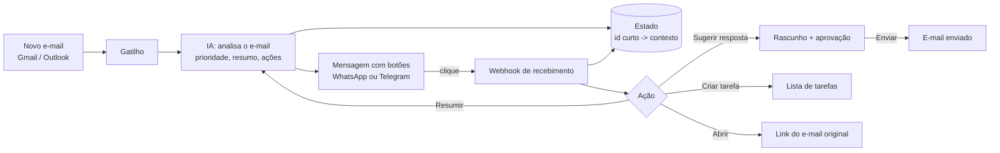

# Assistente de e-mail via WhatsApp

> Receba cada novo e-mail como uma mensagem no WhatsApp, com botões para **abrir**, **resumir**, **sugerir resposta** e **virar tarefa**. Sem abrir a caixa de entrada.
>
> *English: an AI email assistant that pushes new emails to WhatsApp (or Telegram) with interactive buttons: open, summarize, draft a reply, create a task.*

Criado por Amanda. Projeto aberto, licença MIT.

## Como funciona

Princípios:

1. **Nada é enviado sem aprovação.** A IA só sugere; quem decide é a pessoa.
2. **Botões de verdade**, não comandos de texto.
3. **Notificar pouco.** Prioridade visível, agrupamento por conversa e resumo diário.
4. **Privacidade primeiro.** Dados sensíveis são removidos antes de chegar à IA (veja [docs/seguranca-privacidade.md](docs/seguranca-privacidade.md)).

## Status

| Parte | Situação |
|---|---|
| Notificação de novo e-mail com botões (WhatsApp Cloud API) | Protótipo funcionando em n8n |
| Recebimento de cliques (webhook) | Em validação |
| Resumo, sugestão de resposta, tarefa | Especificados em [docs/fluxo-de-botoes.md](docs/fluxo-de-botoes.md) e [prompts/](prompts/) |
| Versão 100% gratuita | Em estudo, veja [docs/custos.md](docs/custos.md) |
| Outlook / Microsoft 365 | Planejado (começamos pelo Gmail) |

## Documentação

- [docs/arquitetura.md](docs/arquitetura.md): camadas e decisões
- [docs/fluxo-de-botoes.md](docs/fluxo-de-botoes.md): telas e botões
- [docs/custos.md](docs/custos.md): quanto custa cada peça e como chegar a zero
- [docs/setup-whatsapp-cloud-api.md](docs/setup-whatsapp-cloud-api.md): passo a passo e armadilhas da Meta
- [docs/seguranca-privacidade.md](docs/seguranca-privacidade.md)
- [prompts/](prompts/) e [schemas/](schemas/): instruções da IA e formato da resposta

## Segredos

Nunca coloque tokens, IDs de conta ou números de telefone no repositório. Use variáveis de ambiente (veja `.env.example`) ou o cofre de credenciais da ferramenta que você usar.

## Licença

MIT, veja [LICENSE](LICENSE).
